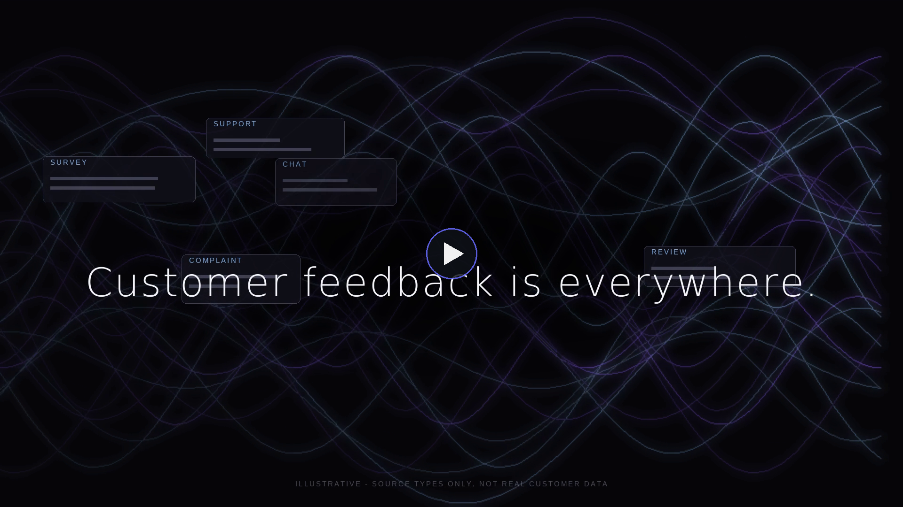
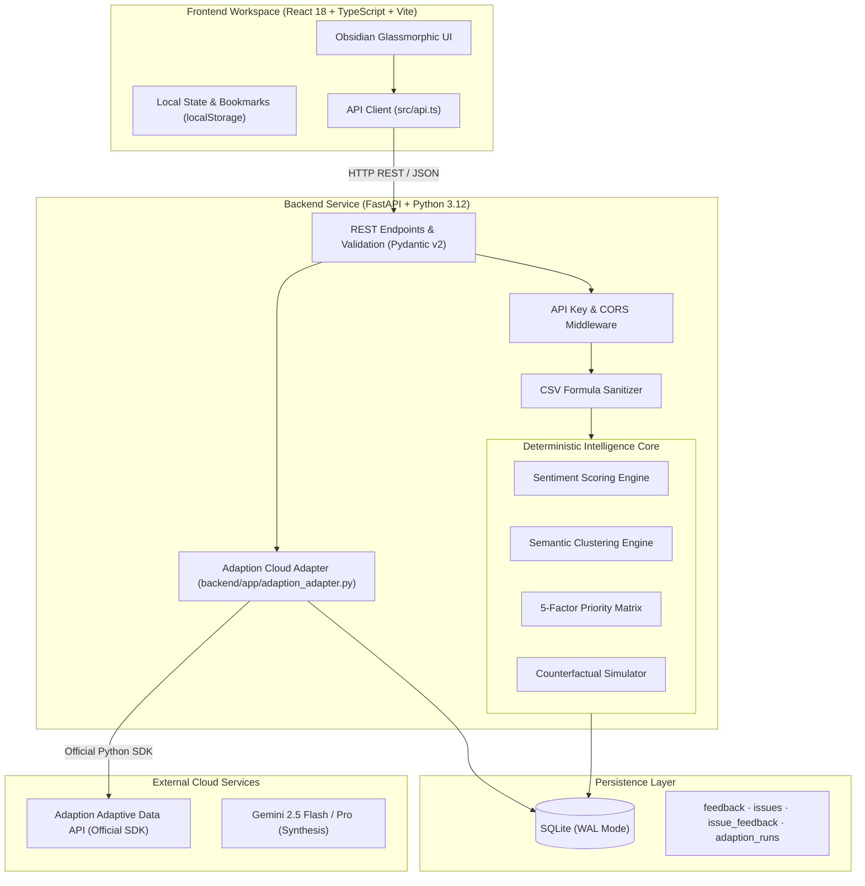

<div align="center">

<a href="https://github.com/indrak31/VANTA">
  <picture>
    <source media="(prefers-color-scheme: dark)" srcset="docs/assets/vanta-brand.png">
    <source media="(prefers-color-scheme: light)" srcset="docs/assets/vanta-brand-dark.png">
    
  </picture>
</a>

<h2>Signal OS</h2>
<p><strong>Autonomous Customer Intelligence & Decision Analytics Platform</strong></p>

[](https://github.com/indrak31/VANTA)
[](LICENSE)

<p align="center">
  
  
  
  
  
  
  
  
</p>

**Every signal. One clear direction.**  
*VANTA transforms unstructured, multi-channel customer language into deterministic issue clusters, explainable priority rankings, counterfactual simulations, and continuous fine-tuning pipelines.*

[Key Features](#-key-features) • [Cinematic Film](#-cinematic-product-film) • [System Architecture](#-system-architecture) • [Priority Formula](#-deterministic-priority-matrix) • [Quickstart](#-quickstart-guide) • [Deployment Guide](DEPLOYMENT.md) • [API Reference](#-api-reference) • [Adaption Integration](#-adaption-ai-cloud-integration)

<br/>

<a href="docs/assets/vanta_demo.mp4" title="Watch the VANTA Cinematic Product Film">
  
</a>

<p align="center">
  <em>▶ <strong><a href="docs/assets/vanta_demo.mp4">Click to watch the 1080p Cinematic Film (24s · 30 FPS · docs/assets/vanta_demo.mp4)</a></strong></em>
</p>

</div>

---

## 📌 Executive Summary

Modern product and engineering teams drown in fragmented customer feedback across Zendesk, Discord, G2, in-app NPS surveys, and customer interviews. Critical issues get lost in narrative ambiguity, subjective opinion, and slow manual triage.

**VANTA Signal OS** replaces guesswork with an **evidence-first, deterministic operating loop**:

$$\textbf{Ingest} \longrightarrow \textbf{Analyze} \longrightarrow \textbf{Cluster} \longrightarrow \textbf{Investigate} \longrightarrow \textbf{Prioritize} \longrightarrow \textbf{Simulate} \longrightarrow \textbf{Adapt} \longrightarrow \textbf{Measure}$$

- **100% Traceable Provenance**: Every metric, priority score, and recommendation links directly to exact customer verbatim quotations and source records.
- **Explainable Mathematics**: Issue rankings are driven by an auditable 5-factor formula, not opaque black-box hallucination.
- **Live Counterfactual Simulation**: Model the rank and churn impact of proposed engineering fixes before committing sprint resources.
- **Adaptive Data Flywheel**: Bridges customer intelligence directly into the official **Adaption AI** fine-tuning loop with verifiable receipts and brand guardrails.

---

## ⚡ Key Features

| Surface | Capability | Impact |
| :--- | :--- | :--- |
| **Executive Overview** | Real-time signal convergence, sentiment trajectory split, high-velocity issue leaderboard, and next best moves. | Gives engineering leadership an instant, auditable pulse on user satisfaction and urgent risks. |
| **Feedback Explorer** | Multi-channel tabular repository with instant keyword search, sentiment/channel filters, quotation inspection, and CSV ingestion. | Enables deep-dive root cause investigation down to the exact customer quote and timestamp. |
| **Issue Radar** | Semantic issue grouping with transparent 0–100 priority scores, workflow status management (`investigating` → `resolved`), and saved bookmarks. | Eliminates subjective prioritization meetings by grounding roadmaps in mathematical severity. |
| **Recommendations** | Prescriptive action items with confidence ratings, underlying customer rationale cards, and team review states. | Translates raw complaints into actionable engineering tickets and product initiatives. |
| **Counterfactual Simulator** | Real-time interactive parameter sliders (*Response Clarity*, *Onboarding Clarity*, *Search Relevance*) projecting directional rank movement and churn reduction. | Answers *"What happens if we fix Search first versus Onboarding?"* before writing code. |
| **Adaption Lab** | Native cloud integration with the official Adaption Python SDK. Pre-flight credit/time estimation, task-specific column mappings, recipes, and brand guardrails. | Closes the loop by fine-tuning models on curated customer feedback without leaving the workspace. |
| **Reports & Exports** | Sanitized CSV and JSON report exports with automated metadata generation for executive distribution. | Facilitates seamless stakeholder updates with built-in spreadsheet injection defenses. |

---

## 🏗️ System Architecture

VANTA is built on a clean, decoupled architecture with strict data boundaries:



### Architectural Highlights
1. **Frontend**: Pure Vanilla CSS tokens with obsidian dark mode (`#08090C`), glassmorphism, responsive grid layouts, and zero heavy UI component bloat.
2. **Backend**: FastAPI with async execution, strict Pydantic v2 schemas, and dependency injection.
3. **Database**: SQLite configured in Write-Ahead Logging (`WAL`) mode with foreign key constraints enabled for high concurrent read performance.
4. **Honest Provider Integration**: The Adaption adapter records live provider receipts and error states. If credentials are unset, it returns an honest, audit-logged HTTP 503 instead of fabricating artificial metrics.

---

## 📐 Deterministic Priority Matrix

Unlike systems that rely on unpredictable generative prompts to guess issue severity, VANTA scores every issue cluster through a deterministic, auditable formula:

$$\text{Priority Score} = 100 \times \Big( 0.25 \times V + 0.30 \times N + 0.20 \times R_{\text{rate}} + 0.20 \times S_{\text{risk}} + 0.05 \times T \Big)$$

Where each constituent component is normalized to $[0, 1]$:
- $V$ (**Volume**): Frequency of raw feedback items attributed to this issue cluster.
- $N$ (**Negative Rate**): Percentage of customer quotes with negative sentiment.
- $R_{\text{rate}}$ (**Rating Risk**): Severity penalty based on numerical star/CSAT ratings ($5 - \text{average rating}$).
- $S_{\text{risk}}$ (**Sentiment Risk**): Inverted sentiment score normalized from compound polarity.
- $T$ (**Recency**): Decay-weighted frequency of feedback received within the active period.

The backend exposes the exact `priority_breakdown` with each issue so technical leaders can audit the components behind every score.

---

## 🚀 Quickstart Guide

### Prerequisites
- **Python 3.12+**
- **Node.js 18+** & `npm`

---

### 1. Backend Setup

```powershell
# Navigate to the backend directory
cd backend

# Create and activate virtual environment
py -3.12 -m venv .venv
.\.venv\Scripts\Activate.ps1

# Install dependencies
python -m pip install -r requirements-dev.txt

# Configure environment variables
copy .env.example .env

# Seed deterministic dataset
python -m app.seed

# Start FastAPI server
uvicorn app.main:app --reload --port 8000
```

> **API Docs**: Access interactive Swagger documentation at `http://127.0.0.1:8000/docs`.

---

### 2. Frontend Setup

```bash
# In a new terminal, navigate to the frontend directory
cd frontend

# Install dependencies
npm install

# Configure environment variables (points to http://127.0.0.1:8000)
copy .env.example .env

# Launch Vite development server
npm run dev
```

> **Workspace**: Open `http://localhost:5173/` in your browser.

---

### Single-Command Root Execution

From the repository root, you can run:

```bash
# Start frontend from root
npm run dev

# Build production bundle
npm run build
```

---

## 📡 API Reference

All endpoints return standard JSON with RFC 7807 problem details on error.

| Method | Endpoint | Description | Request Payload / Query |
| :--- | :--- | :--- | :--- |
| `GET` | `/health` | Service health & Adaption SDK availability | None |
| `GET` | `/api/feedback` | List multi-channel feedback | `?sentiment=negative&limit=100` |
| `POST` | `/api/feedback` | Ingest single customer feedback record | `{"text": "...", "rating": 2, "source": "Zendesk"}` |
| `POST` | `/api/feedback/import` | Safe batch CSV import | `multipart/form-data` (`file`) |
| `GET` | `/api/issues` | Retrieve ranked issue clusters | None |
| `PATCH` | `/api/issues/{id}/status` | Update workflow lifecycle state | `{"status": "in_progress"}` |
| `GET` | `/api/analysis/summary` | Aggregate executive KPI summary | None |
| `GET` | `/api/recommendations` | Evidence-backed recommendations | None |
| `POST` | `/api/scenarios/compare` | Run counterfactual scenario delta | `{"response_clarity": 0.8, "search_relevance": 0.9}` |
| `GET` | `/api/reports/export` | Export sanitized report artifact | `?format=csv` or `?format=json` |
| `GET` | `/api/adaption/status` | Check Adaption Cloud connectivity | None |
| `POST` | `/api/adaption/estimate` | Pre-flight cost & runtime estimation | `{"dataset_id": "...", "column_mapping": {...}}` |
| `POST` | `/api/adaption/run` | Execute adaptive fine-tuning run | `{"dataset_id": "...", "column_mapping": {...}}` |
| `GET` | `/api/adaption/status/{id}` | Poll live remote dataset status | Remote `dataset_id` path param |

---

## 🔮 Adaption AI Cloud Integration

VANTA integrates with the official **Adaption Adaptive Data API** via the `adaption` Python SDK:

1. **Dataset Selection & Validation**: Real remote datasets (`user_feedback_classification`, `vanta_signals_7830`) are discovered and displayed with live row counts and availability states (`awaiting_input` vs. `running`).
2. **Pre-flight Estimation**: Computes required credits and runtime duration before spending quota.
3. **Automatic Row Clamping Safeguard**: When running fine-tuning operations, the backend dynamically verifies requested rows against the remote dataset's actual row count, preventing `HTTP 400: samples_to_process cannot exceed dataset row_count` errors.
4. **Brand Safety & Recipe Guardrails**: Enforces concise length, hallucination mitigation blueprints, and deduplication recipes.
5. **No Synthetic Fabrication**: If `ADAPTION_API_KEY` is not present, VANTA stores a persisted `503 adaption_not_configured` receipt. Zero fake metrics are ever shown.

---

## 🛡️ Security & Data Integrity

- **CSV Formula Injection Neutralization**: All exported and imported CSV records sanitize characters (`=`, `+`, `-`, `@`, `\t`, `\r`) to eliminate spreadsheet injection risks.
- **Strict Bounded Ingestion**: `MAX_CSV_BYTES` (default 2 MB) and `MAX_CSV_ROWS` (default 10,000) prevent denial-of-service memory exhaustion.
- **XSS Prevention**: Customer feedback verbatim strings are rendered strictly as text nodes in React, completely bypassing HTML parsing.
- **Server-Side Secret Isolation**: `ADAPTION_API_KEY` is exclusively managed in the Python backend environment and is never bundled into client-side JavaScript.
- **Optional API Protection**: Setting `VANTA_API_KEY` automatically enforces `X-API-Key` authentication across all protected API routes.

---

## 📁 Repository Structure

```text
VANTA/
├── .github/
│   ├── ISSUE_TEMPLATE/
│   │   ├── bug_report.md
│   │   └── feature_request.md
│   └── PULL_REQUEST_TEMPLATE.md
├── backend/
│   ├── app/
│   │   ├── __init__.py
│   │   ├── adaption_adapter.py    # Official Adaption SDK integration & safeguards
│   │   ├── analysis.py            # Sentiment, clustering, & priority formula
│   │   ├── config.py              # Environment configuration & settings
│   │   ├── db.py                  # SQLite WAL-mode schema & connection manager
│   │   ├── main.py                # FastAPI routes & middleware
│   │   ├── models.py              # Pydantic v2 schemas
│   │   └── seed.py                # Deterministic demonstration seed data
│   ├── data/                      # Local SQLite persistence directory
│   ├── tests/                     # Pytest automated test suite
│   ├── .env.example
│   ├── requirements.txt
│   ├── requirements-dev.txt
│   ├── requirements-adaption.txt
│   └── README.md
├── frontend/
│   ├── public/                    # Static assets & brand graphics
│   ├── src/
│   │   ├── components/            # Reusable UI widgets & WorkspaceLoader
│   │   ├── landing/               # 3D interactive hero canvas & landing page
│   │   ├── api.ts                 # Typed backend client & error handling
│   │   ├── data.ts                # Seed dataset for offline demo mode
│   │   ├── types.ts               # Strict TypeScript domain interfaces
│   │   ├── App.tsx                # Main workspace application (7 views)
│   │   └── index.css              # Obsidian design system & glassmorphism tokens
│   ├── .env.example
│   ├── package.json
│   ├── tsconfig.json
│   ├── vite.config.ts
│   └── README.md
├── docs/
│   ├── architecture.md            # In-depth architectural design
│   └── demo-script.md             # 3-minute executive presentation walkthrough
├── .gitignore
├── CONTRIBUTING.md
├── LICENSE
├── package.json
└── README.md
```

---

## 🧪 Testing & Verification Suite

### Backend Test Suite
```powershell
cd backend
.\.venv\Scripts\python.exe -m pytest -q
# Output: 8 passed in 0.42s

.\.venv\Scripts\python.exe -m compileall -q app tests
# Output: Bytecode compilation verified clean
```

### Frontend Typecheck & Production Build
```bash
cd frontend
npm run typecheck
# Output: 0 TypeScript errors

npm run build
# Output: ✓ built in 7.14s (dist/ verified)
```

---

## 🎯 3-Minute Demo Script

1. **Executive Overview (0:00–0:30)**: Highlight the real-time feedback volume, sentiment trajectory, and top priority issues. Open an issue drawer to reveal the mathematical score breakdown.
2. **Feedback Explorer (0:30–1:00)**: Filter by negative sentiment, search for keywords (e.g. `latency` or `search`), inspect raw quotes, and demonstrate manual ingestion.
3. **Issue Radar (1:00–1:30)**: Sort by priority, transition an issue status to `in_progress`, and bookmark it for persistence across sessions.
4. **Counterfactual Simulator (1:30–2:15)**: Adjust the *Response Clarity* slider to +40%. Observe immediate real-time rank reordering and churn risk reduction before committing engineering time.
5. **Adaption Lab (2:15–2:45)**: Inspect cloud datasets (`user_feedback_classification`), trigger a live pre-flight credit/time estimate, and inspect the provider receipt.
6. **Reports & Exports (2:45–3:00)**: Download the sanitized CSV report and demonstrate safe formula neutralization.

---

## 📄 License & Hackathon Credits

Built with passion for the **Frontend Arena Build Battle 2026**.  
Distributed under the **[MIT License](LICENSE)**. © 2026 VANTA Contributors.
