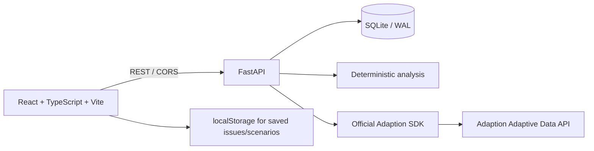

# Vanta Signal OS

Vanta Signal OS is the rebranded customer-intelligence decision system for the Frontend Arena Build Battle 2026. It turns raw customer language into a traceable operating loop:

**Ingest → Analyze → Cluster → Investigate → Prioritize → Simulate → Act → Measure**

The product is intentionally evidence-first. Deterministic calculations are used for sentiment, issue clustering, priority scoring, and scenario comparisons. Provider-backed Adaption runs are shown only when the backend receives real provider responses.

## What is implemented

- **Overview:** data-derived feedback count, sentiment mix, trend view, ranked issues, recent evidence, and next moves.
- **Feedback Explorer:** searchable/filterable evidence table, feedback detail inspection, manual submission, bounded CSV import, and source-safe rendering.
- **Issue Radar:** recurring issue clusters, priority score breakdown, evidence drawer, saved issues, status workflow in the API, and owner context.
- **Recommendations:** evidence-linked recommendations with confidence, rationale, suggested action, and review workflow.
- **Counterfactual Issue Simulator:** reproducible sliders for response clarity, onboarding clarity, and search relevance; side-by-side baseline/scenario rankings and contribution changes.
- **Adaption Lab:** official SDK-backed availability checks, estimate/run controls, provider receipts, status polling, run errors, dataset IDs, column mapping, recipe settings, and clear separation between planning artifacts and provider output.
- **Reports:** CSV/JSON downloads and a report library surface.

## Architecture



- `frontend/` is the responsive operational workspace.
- `backend/app/analysis.py` owns sentiment, issue assignment, and transparent priority formulas.
- `backend/app/db.py` keeps raw feedback, issues, memberships, and Adaption run history separate.
- `backend/app/adaption_adapter.py` lazily initializes `adaption.Adaption` and records unavailable/failed provider states instead of fabricating a successful run.
- SQLite is the default local persistence layer; the schema is deliberately small and portable. A production deployment can move persistence behind the same repository boundary.

## Run locally

### Backend

```powershell
cd backend
py -3.12 -m venv .venv
.\.venv\Scripts\Activate.ps1
python -m pip install -r requirements-dev.txt
copy .env.example .env
python -m app.seed
uvicorn app.main:app --reload --port 8000
```

The API is at `http://127.0.0.1:8000` and OpenAPI is at `/docs`.

Optional Adaption support:

```powershell
python -m pip install -r requirements-adaption.txt
$env:ADAPTION_API_KEY = "use-a-real-key-locally"
```

The API can run without the key and SDK. Adaption actions then return a persisted, honest `503 adaption_not_configured` receipt.

### Frontend

```powershell
cd frontend
npm install
copy .env.example .env
npm run dev
```

Open the Vite URL shown in the terminal. Without `VITE_API_URL`, the UI uses its clearly labeled local demo dataset. With `VITE_API_URL=http://127.0.0.1:8000`, the workspace loads API-backed feedback, issues, and recommendations.

## Adaption integration notes

The implementation follows the official Adaptive Data flow documented by Adaption:

1. A real Adaption dataset ID is entered in Adaption Lab.
2. InsightFlow sends a task-specific column mapping, bounded job specification, recipe settings, and grounded blueprint to `datasets.adapt` through the official Python SDK.
3. Estimate and launch are separate actions.
4. The backend stores local run history with the provider run/dataset identifiers and raw response payload.
5. In-progress status is refreshed through `datasets.get_status`.
6. Provider errors, missing SDK installation, and missing `ADAPTION_API_KEY` remain visible to the user.

This project does not claim a successful provider run or evaluation metric unless a real key, dataset, and provider response are supplied. The built-in experiment portfolio is labeled as planning data, not Adaption output.

Reference pages used during implementation:

- https://docs.adaptionlabs.ai/adaptive-data-quickstart/
- https://docs.adaptionlabs.ai/tutorials/adaptive-data-app-walkthrough/
- https://docs.adaptionlabs.ai/adaptive-data/configure-adaptive-data/

## Checks actually run

From `backend/`:

```powershell
.\.venv\Scripts\python.exe -m pytest -q
# 8 passed
.\.venv\Scripts\python.exe -m compileall -q app tests
# passed
```

From `frontend/`:

```powershell
npm run typecheck
# passed
npm run build
# passed; Vite emitted a non-blocking >500 kB main-chunk warning
```

The API smoke checks also verified `/health`, `/api/issues`, `/api/reports/export?format=json`, and the missing-key Adaption estimate path returning `503 adaption_not_configured` while preserving a run receipt.

## Demonstration script (three minutes)

1. **Overview — 25 seconds:** call out the measured feedback count, current sentiment mix, and top issue table. Open the response-state issue to show the deterministic score inputs and linked quotations.
2. **Feedback Explorer — 30 seconds:** search for “search”, filter to negative feedback, open a source record, then add one manual record. If the API is connected, show that it is persisted and re-analyzed.
3. **Issue Radar — 25 seconds:** sort by priority, save an issue, and open its evidence drawer. Explain that priority is a formula, not a generated label.
4. **Simulator — 45 seconds:** increase response-state clarity and search relevance. Compare baseline versus scenario rankings and show which positions changed. State that these are directional model estimates, not causal claims.
5. **Adaption Lab — 45 seconds:** show provider readiness. Enter a real Adaption dataset ID, request an estimate, and launch only when a real key is configured. Show the receipt/status polling. If credentials are unavailable, demonstrate the honest configuration error and explain that no fake metric is shown.
6. **Reports — 10 seconds:** download the current CSV or JSON report and explain the provenance boundary.

## Deployment and submission status

No Vercel, backend-hosting, or GitHub credentials are available in this workspace, and this directory is not currently a Git repository. Therefore no public deployment URL or repository URL is claimed. The app is buildable locally and is ready to deploy once a repository, frontend host, backend host, database choice, CORS origin, and `ADAPTION_API_KEY` are provided.

Known gaps are intentionally explicit: the backend's clustering fallback is deterministic taxonomy/keyword clustering rather than an embedding model; the frontend demo dataset is synthetic until the API is connected; and multi-tenant authentication/authorization needs to be added before production customer data is handled. The Adaption adapter is real and provider-backed, but a live provider run and evaluation metric were not possible without a supplied key and dataset.

See `docs/architecture.md` and `docs/demo-script.md` for the handoff artifacts.
